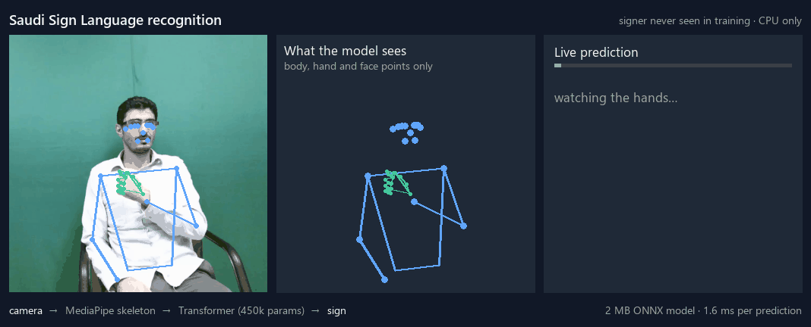

# Saudi Sign Language Recognition

[](https://github.com/meshalbr/saudi-sign-language-recognition/actions/workflows/ci.yml)

Live recognition of Saudi Sign Language from a laptop webcam or a phone camera, running on a
laptop with no graphics card.

**[Try it live in your browser](https://meshalbr.github.io/saudi-sign-language-recognition/)**: allow the camera, sit back so both hands are
visible, sign, then rest your hands. The **Words** tab shows how each sign is made. Everything runs on your
own device (MediaPipe, the preprocessing and the 2 MB model), and no video or points are sent anywhere.



*The signer in this clip was never seen during training (leave-one-signer-out model). Left:
the camera with the skeleton MediaPipe finds. Middle: the only input the model gets, which is
points and no video. Right: the top-3 prediction, updated live as the sign happens. The five
signs are heart, hospital, fever, eat and sleep, and all five came out correct on the first try.
Made with [`scripts/make_demo.py`](scripts/make_demo.py) from KArSL test videos.*

## Highlights

- **85.8% top-1 / 97.2% top-5 on signers the model has never seen** (KArSL-100, 100 signs,
  leave-one-signer-out). The published signer-independent result on this benchmark is 68.2%.
- **99.7%** on the official KArSL-100 test split.
- **2 MB ONNX model, under 2 ms per prediction** on a laptop CPU; trained on the same laptop.
- **Privacy by design:** the model sees only skeleton points, never the video.
- **Works in real conditions:** recovers hands that touch the chest, handles upright phone
  cameras and mirrored video, and ends a sign when the hands rest.
- **Browser app** for laptop and phone (phone joins with a QR code), with live Arabic and
  English results and a practice mode.

## How it works

```
camera  ->  MediaPipe (body, hands, 13 face points)  ->  normalise to the shoulders
        ->  32-frame landmark sequence              ->  Transformer (450k params)  ->  sign
```

The camera never reaches the neural network, so training data is tiny and inference is fast
on a CPU.

## Results

| Evaluation | Top-1 | Top-5 |
|---|---|---|
| New signers (leave-one-signer-out, mean of 3 folds) | **85.8%** | **97.2%** |
| Official KArSL-100 test split (2,400 clips) | **99.7%** | 100% |
| Published signer-independent result, same benchmark | 68.2% | |

| Stage, laptop CPU | Time |
|---|---|
| Classifier, ONNX Runtime | 1.6 ms |
| MediaPipe landmarks, 640x480 | 71 ms (about 15 FPS) |

Full experiment log: [`reports/results.md`](reports/results.md).

## Run it

```
pip install torch --index-url https://download.pytorch.org/whl/cpu
pip install -e ".[dev,app]"
python scripts/download_models.py                          # MediaPipe models + trained model
python -m app.server --run runs/final_v3_face --https     # browser app, laptop and phone
```

`download_models.py` fetches the two MediaPipe models from Google and the trained model from
the [v1.0 release](https://github.com/meshalbr/saudi-sign-language-recognition/releases/tag/v1.0)
(2 MB ONNX + PyTorch checkpoint + sign names) and one reference clip per sign (skeleton and a
short video strip), so no training is needed to try it.

### The live demo (no server)

The [live demo](https://meshalbr.github.io/saudi-sign-language-recognition/) is the same page
running without the Python server. [`app/static/engine.js`](app/static/engine.js) is a
line-by-line port of the server path (gap filling, smoothing, motion trimming, resampling, the
feature transform, the sign segmenter and the best-window search). It runs the ONNX model with
ONNX Runtime Web. Two checks keep it identical to Python:

- `tests/test_engine_parity.py` runs the JavaScript under Node on the same clips and live streams as
  the Python code, and requires the same model inputs and the same sign boundaries. It runs on every
  push, and the site is deployed only if it passes.
- In a real browser engine, the probabilities on 10 recorded signs differ from Python's ONNX
  Runtime by at most 3e-7, and the full live path recognised all 10.

`python scripts/build_site.py --out site` builds it after `download_models.py`.

### With Docker

```
docker run -p 7860:7860 ghcr.io/meshalbr/saudi-sign-language-recognition
```

Then open http://localhost:7860. The CPU-only image is built, started and tested by GitHub Actions on every push.
The test streams real sign recordings through the WebSocket and checks that the signs come back correct,
and only then is the image published.
The image starts in **public mode**: each visitor gets their own session, nothing is saved, and
the phone relay and teach mode are off (add `-e SSL_PUBLIC=0` for the full app on your own machine).

| Task | Command |
|---|---|
| Live webcam demo | `python -m ssl_recognition.infer --run runs/final_v3_face --onnx` |
| Train the deployment model | `python -m ssl_recognition.train --config configs/final_tf_all_official.yaml` |
| Export to ONNX | `python scripts/export_onnx.py --run runs/final_v3_face` |
| Benchmark | `python scripts/benchmark_cpu.py --run runs/final_v3_face` |
| Rebuild the demo GIF | `python scripts/make_demo.py --run runs/p6_s02_face --signer s02 --every 3` |
| Tests | `pytest -q && ruff check .` |

## Stack

Python, PyTorch, MediaPipe, ONNX Runtime, FastAPI, WebSockets, GitHub Actions.

## Data

[KArSL](https://hamzah-luqman.github.io/KArSL/) (KFUPM): 502 isolated Arabic signs, 3 signers.
KArSL-100 is signs 0071 to 0170.

The Practice and Words tabs show one short reference clip per sign (24 frames of signer 01,
240 px, cropped to the signer by [`scripts/make_sprites.py`](scripts/make_sprites.py)) so users
can copy the movement. These clips come from KArSL: Sidig, Luqman, Mahmoud and Mohandes,
"KArSL: Arabic Sign Language Database", *ACM TALLIP* 20(1), 2021. They are shown only to teach
the signs, in a free, non-commercial demo. If you are a KArSL author and want them removed, please
open an issue and they will be taken down.

## Licence

MIT for the code. Dataset licences belong to their owners.
